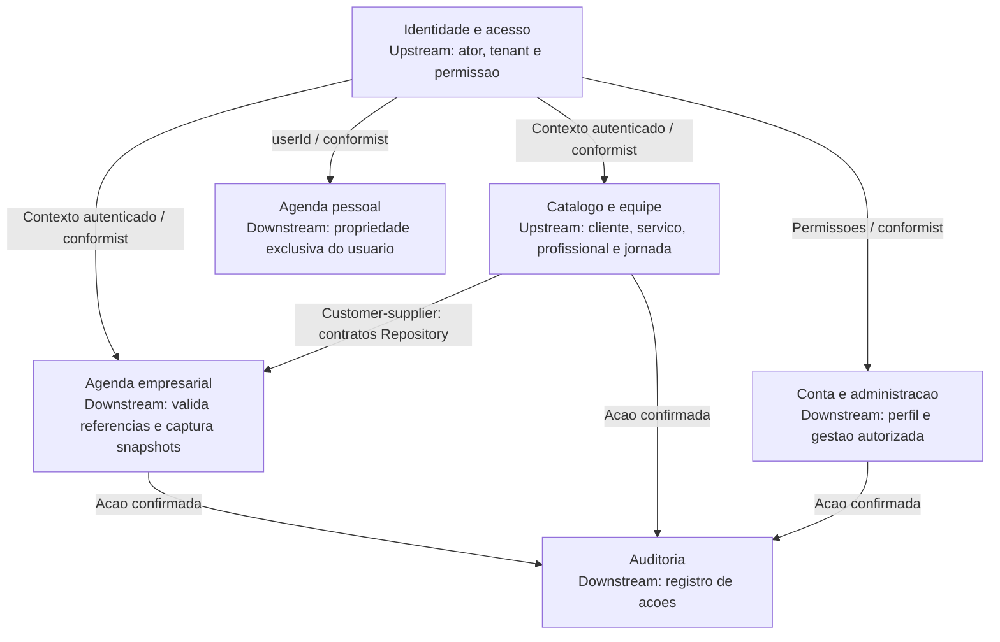
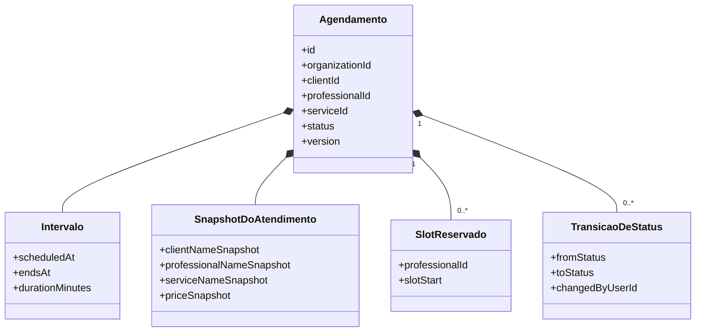

# Dominios, contextos e modelo de Agenda

Modelo aplicado ao codigo em 26/10/2026. DDD aqui organiza linguagem e consistencia; nao significa que cada contexto seja um microsservico ou que toda tabela seja um agregado.

## Dominios e limites

| Contexto | Subdominio | Responsabilidade e propriedade | Codigo |
| --- | --- | --- | --- |
| Agenda empresarial | Core | Atendimento, snapshots, status, reserva e conflitos | `modules/appointments` |
| Agenda pessoal | Core | Compromissos privados, datas e conclusao | `modules/personal-events` |
| Catalogo e equipe | Suporte | Clientes, servicos, profissionais, jornadas e bloqueios | `modules/clients`, `services`, `professionals` |
| Identidade e acesso | Generico/suporte | Credenciais, sessoes, papeis e permissoes | `modules/auth`, `platform/tenancy` |
| Conta e administracao | Suporte | Perfil/avatar e gestao autorizada de usuarios | `modules/users`, `modules/admin` |
| Auditoria | Suporte | Historico de acoes e correlacao, sem substituir o estado de negocio | `platform/audit` |

Redis, SQL, HTTP, UI e SQLite sao tecnologia/adaptadores, nao novos dominios de negocio. Pagamentos, lembretes e notificacoes existentes no schema/propostas nao constituem contextos funcionais completos nesta entrega.

## Context Map

As setas indicam fornecedor para consumidor, nao fluxo de login nem relacoes de banco. Integracao e por chamadas internas e contratos tipados, nao RPC. Identidade fornece o contexto compartilhado via AsyncLocalStorage; isso e acoplamento de plataforma explicitamente assumido, nao um contrato remoto versionado.

## Linguagem e agregado empresarial

Um **Agendamento** reserva o intervalo de um profissional para executar um servico para um cliente. **Compromisso pessoal** nao tem profissional nem servico. **Disponibilidade** depende de jornada, bloqueios e reservas ativas. **Organizacao** e o limite de compartilhamento, nao sinonimo de usuario.

Raiz de agregado: Agendamento, identificado por `id` e `organizationId` (ou propriedade legada de usuario). Entidades internas: reservas de slots e entradas de historico de status. Cliente, profissional e servico sao referencias de outros agregados, nunca objetos que o agendamento deve editar em cascata.

**Value Objects do modelo:** intervalo de tempo (inicio/fim/duracao), valor monetario do snapshot e conjunto de nomes capturados. Sao valores sem identidade propria. **Representacao atual:** campos Date/number/string no DTO e model Sequelize; nao existem classes imutaveis chamadas `Intervalo` ou `SnapshotDoAtendimento` no codigo. O diagrama mostra o agrupamento de dominio, nao inventa classes implementadas. Uma refatoracao para VOs explicitos deve preservar os contratos e receber testes proprios.

## Invariantes e fronteira transacional

| Invariante | Onde e garantida | Evidencia |
| --- | --- | --- |
| Referencias existem e pertencem ao tenant ativo | Services + repositories com `buildTenantWhere` | Testes de autorizacao e integracao multiempresa |
| Inicio/fim, duracao, jornada, intervalo e bloqueio validos | `SchedulingPolicyService`, service de criacao/alteracao | Suites de scheduling policy e agendamentos |
| Nao reservar duas vezes o mesmo profissional/slot | Indice unico de `appointment_slots` + transacao | Teste PostgreSQL de concorrencia |
| Edicao com versao antiga rejeitada | Comparacao de `version`, lock e erro de conflito | Teste de versao concorrente |
| Reserva e historico acompanham alteracao | `SequelizeAppointmentRepository` dentro da transacao | Criacao/update/swap com rollback em falha |
| Alterar catalogo nao altera nomes/preco historicos do atendimento | Campos snapshot do agendamento | Model e migracoes de snapshots |

Criacao/update/swap usam transacao SERIALIZABLE; update bloqueia a raiz, libera/reserva slots e grava historico antes do commit. Trocar dois agendamentos amplia excepcionalmente a transacao para duas raizes, porque a invariante de reserva exige atomicidade; isso e uma escolha de consistencia do monolito, nao independencia absoluta dos agregados.

Limites ainda abertos: regras consultadas em outras tabelas nao constituem um modelo de dominio puro; a verificacao de data passada possui alteracoes locais anteriores que devem entrar em PR proprio antes de se afirmar sua liberacao. CRUD offline com reconciliacao, VO explicito e eventos duraveis permanecem futuros.
