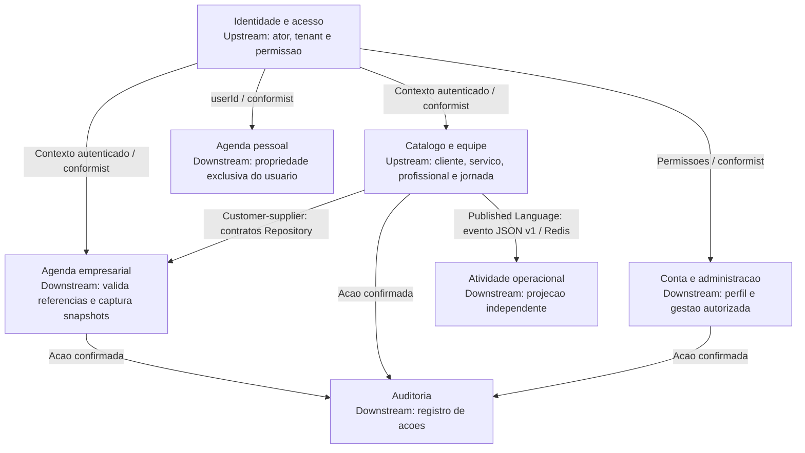
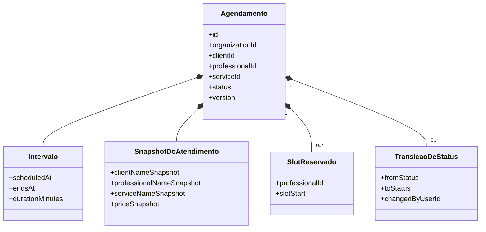

# Dominios, contextos e modelo de Agenda

Modelo revisado em 06/11/2026. DDD aqui organiza linguagem e consistencia; nao significa que cada contexto seja um microsservico ou que toda tabela seja um agregado.

## Dominios e limites

| Contexto | Subdominio | Responsabilidade e propriedade | Codigo |
| --- | --- | --- | --- |
| Agenda empresarial | Core | Atendimento, snapshots, status, reserva e conflitos | `modules/appointments` |
| Agenda pessoal | Core | Compromissos privados, datas e conclusao | `modules/personal-events` |
| Catalogo e equipe | Suporte | Clientes, servicos, profissionais, jornadas e bloqueios | `modules/clients`, `services`, `professionals` |
| Identidade e acesso | Generico/suporte | Credenciais, sessoes, papeis e permissoes | `modules/auth`, `platform/tenancy` |
| Conta e administracao | Suporte | Perfil/avatar e gestao autorizada de usuarios | `modules/users`, `modules/admin` |
| Auditoria | Suporte | Historico de acoes e correlacao, sem substituir o estado de negocio | `platform/audit` |
| Atividade operacional | Suporte | Projecao de eventos recebidos e recibos idempotentes, sem alterar agenda/cadastros | `Microservico-Eventos`, processo e SQLite proprios |

Redis, SQL, HTTP, UI e SQLite sao tecnologia/adaptadores, nao novos dominios de negocio. Pagamentos, lembretes e notificacoes existentes no schema/propostas nao constituem contextos funcionais completos nesta entrega.

## Context Map

As setas indicam fornecedor para consumidor, nao fluxo de login nem relacoes de
banco. Na API, integracao e interna por contratos tipados. A excecao introduzida
em 09/11 e Atividade: contrato JSON v1 assincrono via Redis, sem banco ou codigo
interno compartilhado. Identidade fornece contexto por AsyncLocalStorage apenas
dentro da API; o servico operacional nao herda esse contexto nem autoriza usuarios.

## Linguagem e agregado empresarial

Um **Agendamento** reserva o intervalo de um profissional para executar um servico para um cliente. **Compromisso pessoal** nao tem profissional nem servico. **Disponibilidade** depende de jornada, bloqueios e reservas ativas. **Organizacao** e o limite de compartilhamento, nao sinonimo de usuario.

Raiz de agregado: Agendamento, identificado por `id` e `organizationId` (ou propriedade legada de usuario). Entidades internas: reservas de slots e entradas de historico de status. Cliente, profissional e servico sao referencias de outros agregados, nunca objetos que o agendamento deve editar em cascata.

**Value Objects implementados:** `AppointmentInterval` e `ServicePrice`, em `modules/appointments/domain`. O primeiro representa inicio/fim em milissegundos e duracao inteira positiva, devolve copias de Date e usa intervalos semiabertos: um horario que acaba as 10h nao conflita com outro que comeca as 10h. O segundo representa preco nao negativo em centavos inteiros seguros e rejeita mais de duas casas decimais. Ambos sao congelados e possuem igualdade por valor, sem ID.

`CreateAppointmentService` constroi os VOs antes de validar a jornada e grava os valores primitivos no Repository. Datas invalidas, overflow, duracao invalida e preco invalido nao chegam a persistencia. Os DTOs HTTP e o schema relacional nao mudam. Testes: `__tests__/appointments/domain-values.spec.ts`, incluindo uso real pelo service. Nao foi transformado todo model Sequelize em dominio puro: update/swap ainda usam representacoes primitivas; o snapshot de nomes do diagrama acima continua um agrupamento conceitual, nao uma classe implementada.

## Invariantes e fronteira transacional

| Invariante | Onde e garantida | Evidencia |
| --- | --- | --- |
| Referencias existem e pertencem ao tenant ativo | Services + repositories com `buildTenantWhere` | Testes de autorizacao e integracao multiempresa |
| Inicio/fim, duracao, jornada, intervalo e bloqueio validos | `SchedulingPolicyService`, service de criacao/alteracao | Suites de scheduling policy e agendamentos |
| Nao reservar duas vezes o mesmo profissional/slot | Indice unico de `appointment_slots` + transacao | Teste PostgreSQL de concorrencia |
| Edicao com versao antiga rejeitada | Comparacao de `version`, lock e erro de conflito | Teste de versao concorrente |
| Reserva e historico acompanham alteracao | `SequelizeAppointmentRepository` dentro da transacao | Criacao/update/swap com rollback em falha |
| Alterar catalogo nao altera nomes/preco historicos do atendimento | Campos snapshot do agendamento | Model e migracoes de snapshots |

Criacao/update/swap usam transacao SERIALIZABLE; update bloqueia a raiz, libera/reserva slots e grava historico antes do commit. Trocar dois agendamentos amplia excepcionalmente a transacao para duas raizes, porque a invariante de reserva exige atomicidade; isso e uma escolha de consistencia do monolito, nao independencia absoluta dos agregados.

Limites ainda abertos: regras consultadas em outras tabelas nao constituem um modelo de dominio puro; a verificacao de data passada possui alteracoes locais anteriores que devem entrar em PR proprio antes de se afirmar sua liberacao. CRUD offline com reconciliacao, adocao dos VOs em update/swap e eventos duraveis permanecem futuros.
