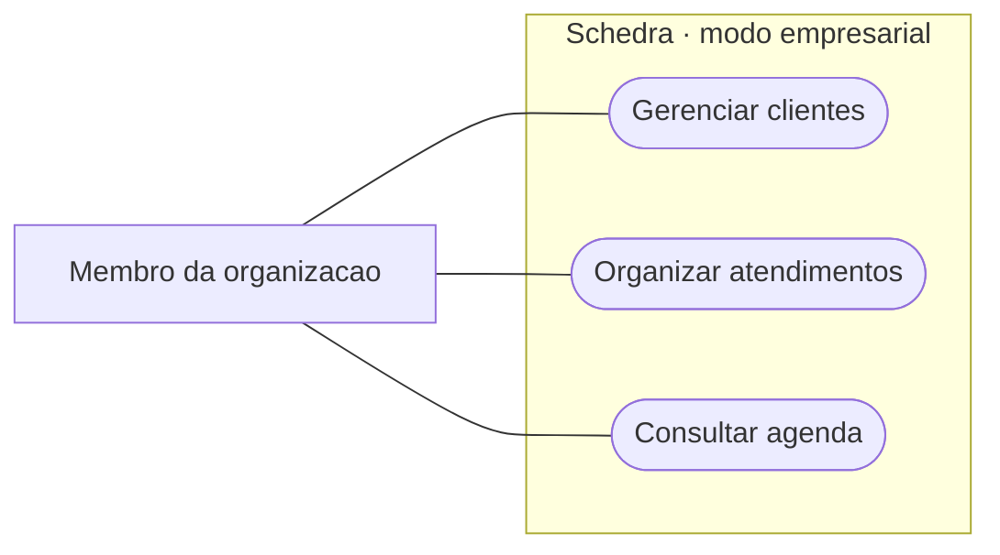
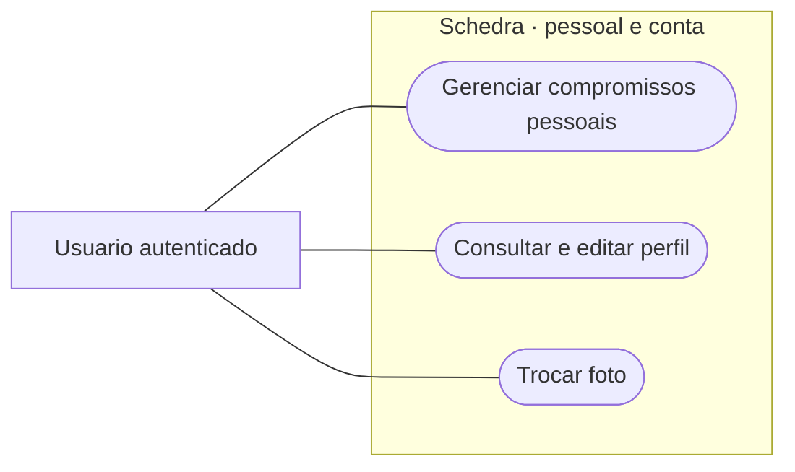
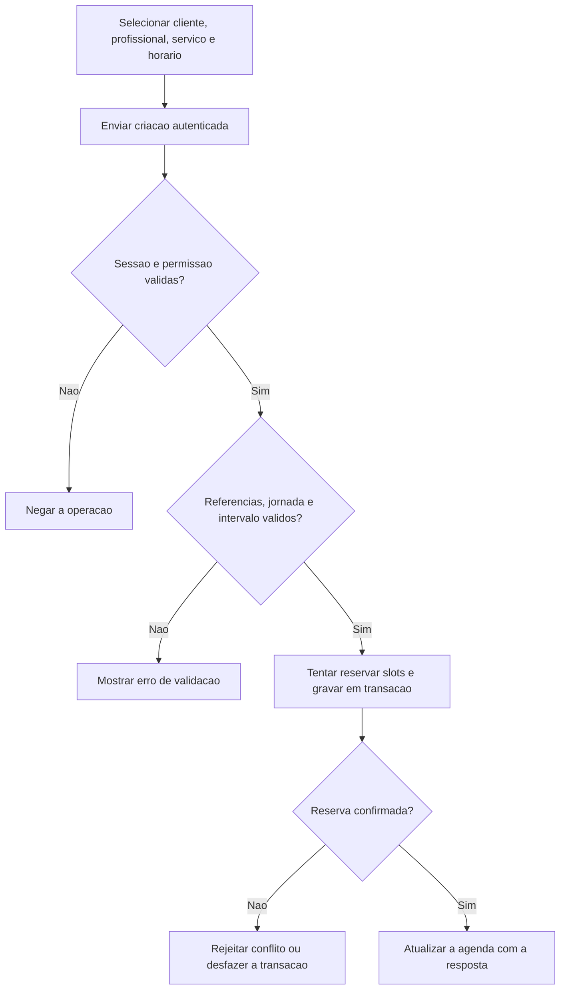
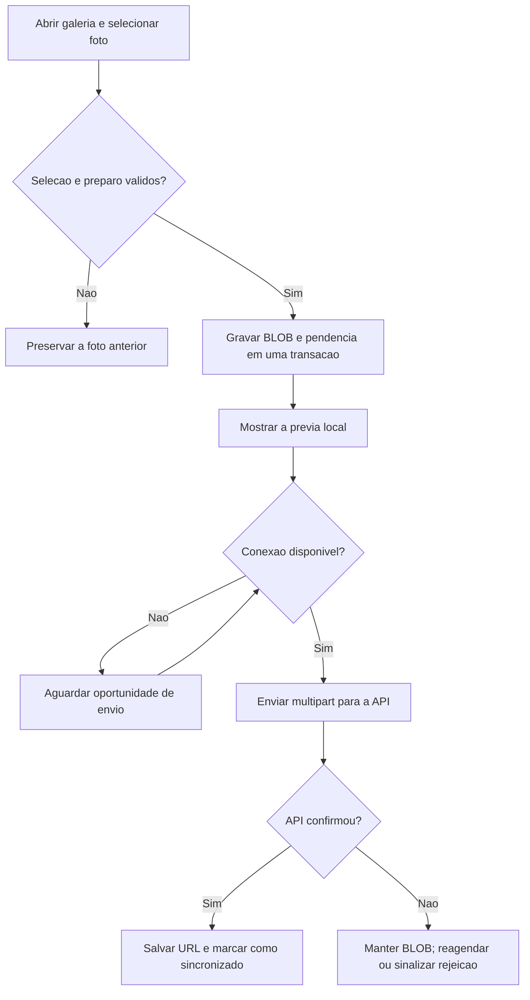
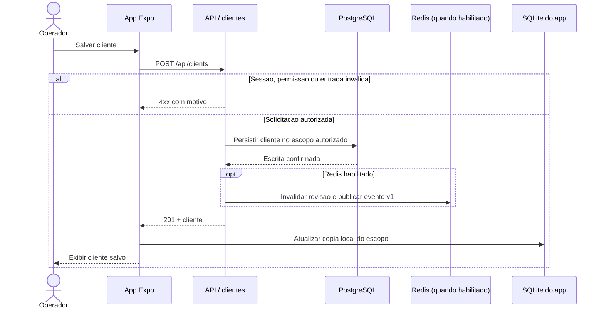
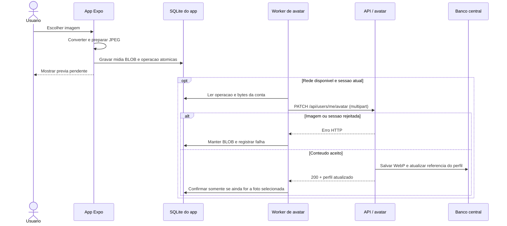
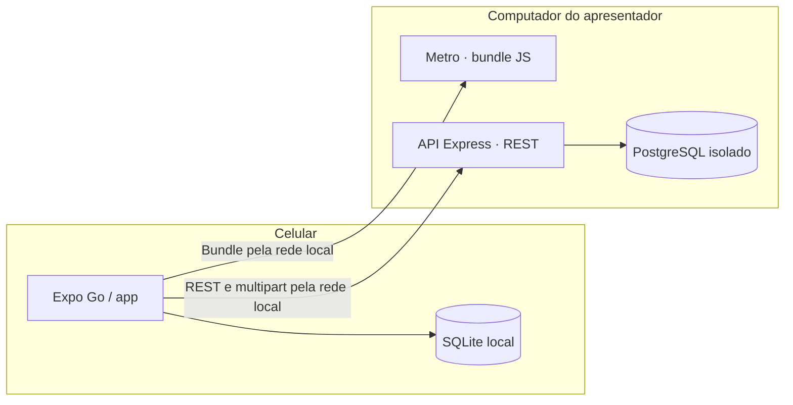

# Fluxos atuais do Schedra

Este documento mostra a versao integrada em `fd8a836`. [Os diagramas de evolucao](../DIAGRAMS.md) descrevem propostas, nao comportamento entregue. Veja tambem [C4 e DDD](README.md), [OpenAPI](../api/openapi.json) e [persistencia local](../SQLITE_LOCAL.md).

## Casos de uso

### UC01: Organizar agenda e clientes da empresa

**Ator:** membro autorizado da organizacao. **Entrada:** sessao valida, organizacao ativa e permissao da operacao. **Resultado:** cliente ou agendamento persistido no banco central; a copia local e atualizada apos a resposta.

O backend valida as referencias e a disponibilidade. Sem permissao ou com conflito, rejeita a operacao. Sem conexao, o app pode ler dados ja salvos; nao enfileira novos agendamentos.

### UC02: Gerenciar compromissos pessoais e perfil

**Ator:** usuario autenticado. **Entrada:** sessao valida. **Resultado:** compromissos privados mantidos na API; a nova foto pode ficar salva no aparelho antes do envio.

O compromisso pessoal nao exige cliente, profissional ou servico. A foto pertence a conta, nao a empresa ativa. Negar acesso a galeria ou falhar ao preparar a foto nao altera a anterior.

## Atividades

### A01: Criar atendimento

### A02: Trocar avatar

## Sequencias

### S01: Cadastrar cliente e refletir a lista

Falha no Redis nao torna a operacao confirmada em falha de CRUD. Em modo offline, o app le a copia local; o POST nao tem outbox de negocio.

### S02: Persistir e sincronizar avatar

Falha de rede preserva a previa e a operacao local. O identificador da operacao protege o estado local contra respostas antigas; nao comprova deduplicacao do upload no servidor.

## Implantacao para demonstracao

Para mostrar Redis, Nginx, Prometheus e o microsservico de eventos, use o [perfil Compose de validacao](../VALIDACAO_OPERACIONAL.md). A demonstracao de celular pode usar API + PostgreSQL local sem Redis. O banco nao precisa aceitar conexoes da LAN.
