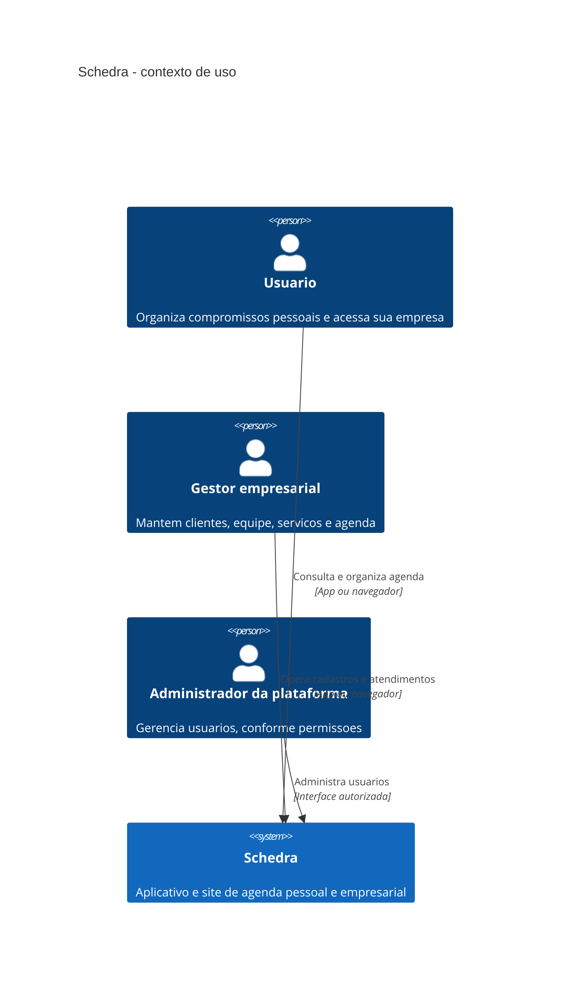
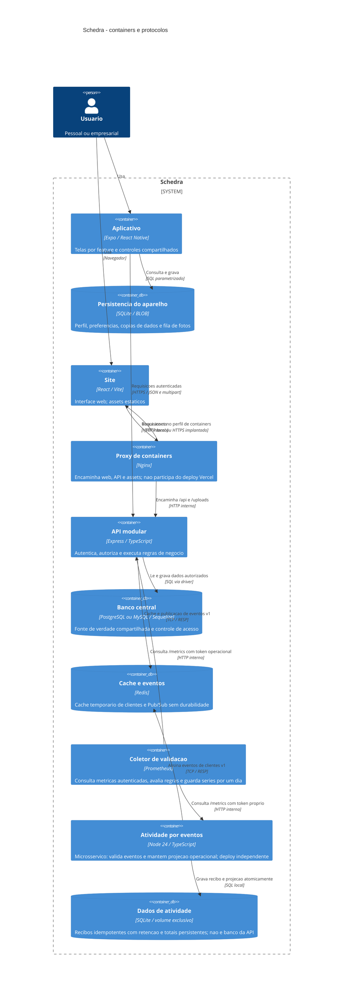
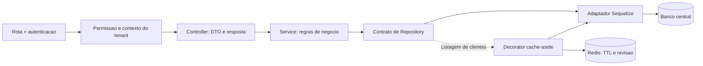

# Arquitetura atual do Schedra

Revisao de 09/11/2026. A API principal permanece modular e ha um microsservico
independente de atividade por eventos, extraido por orientacao docente adicional.
Os modelos antigos de evolucao continuam sendo propostas. Referencias:
[C4](https://c4model.com/diagrams), [dominio](DDD.md), [ADRs](ADRS.md),
[qualidade](QUALITY.md), [Redis](../REDIS_OPERACAO.md),
[microsservico](../../Microservico-Eventos/README.md).

## C4 - Contexto

Autenticacao e banco pertencem ao Schedra; nao sao sistemas externos neste nivel. GitHub, Expo e Vercel sao ferramentas de construcao/entrega, nao atores de agendamento.

## C4 - Containers

No Expo Web, IndexedDB substitui SQLite nativo. Tokens nativos ficam no SecureStore, fora do SQLite. O banco central suporta dois dialetos; a stack de validacao usa PostgreSQL 16. Nao se infere o banco de producao a partir desse perfil. Redis nao armazena permissoes nem decide disponibilidade de horarios.

## Caminho de uma operacao

O decorator envolve o adaptador SQL na composicao do controller. Leituras individuais seguem no banco. Escritas confirmadas invalidam o namespace e publicam evento. Sem Redis, o decorator continua pelo banco; sem banco, Redis nao mascara falhas de autenticacao ou autorizacao.

## Qualidades e limites da estrutura

- API principal modular, mais um microsservico independente de atividade.
  Agenda e autenticacao nao foram reescritas como microsservicos. Cada processo
  possui build/deploy proprio e dados sob sua responsabilidade; eventos sao o
  contrato entre eles, sem imports de codigo interno ou SQL compartilhado.
- Modulos de negocio em `Backend-Schedra/src/modules`; tenancy, auditoria e Redis em `src/platform`; HTTP e utilitarios em `src/shared`.
- Contratos Repository permitem testar services sem banco. Ainda existem acoplamentos diretos de algumas regras ao Sequelize; nao se declara arquitetura hexagonal pura.
- `Aplicativo-Schedra/src/features` agrupa telas, APIs e regras por funcionalidade; `src/shared` contem UI, banco, rede e midia.
- SQLite permite consultas ja salvas e fila de fotos. CRUD de negocio offline, conflitos e idempotencia geral ainda nao foram entregues.
- Pub/Sub exige consumidor duradouro. Agora roda em Microservico-Eventos, nao no
  startup da API. A persistencia de recibos nao recupera eventos perdidos durante
  queda. Funcoes serverless nao garantem assinante continuo; usar processo/container.
- Nginx HTTP e credenciais sinteticas de `compose.validation.yml` sao exclusivamente locais/CI. Producao requer TLS, segredos e infraestrutura proprios.
